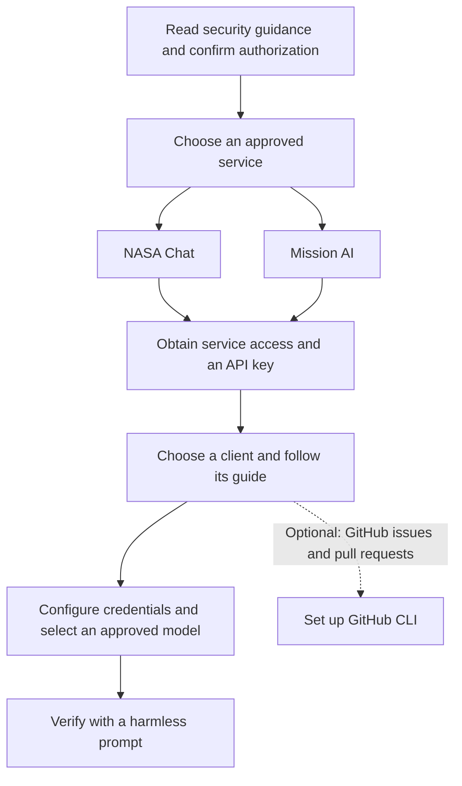

# SI Agent Setup for GMAO

Private, credential-safe guidance for using coding-agent clients and Visual Studio Code with GMAO SI services.

## Start here

1. Read [Security](SECURITY.md) before configuring a client.
2. Confirm that your intended data and repository are approved for the service.
3. Select only the service you are authorized to use.
4. Follow its client-specific instructions. Do not install a configuration for the other service.
5. Obtain service access and configuration values through the approved GMAO channel. Do not request or add credentials in GitHub issues, pull requests, or chat.

## NAS restriction

SI agent harnesses, including the clients documented in this repository, are not allowed on [NASA Advanced Supercomputing (NAS)](https://www.nas.nasa.gov/) systems. Do not install or configure them there.

## Setup at a glance

Choose your service and client from the guides below. For GitHub issue and pull request access, see [GitHub CLI setup](docs/clients/github-cli.md); its login does not authenticate a NASA service.

## Services

OpenCode and Visual Studio Code are the SI Team's primary clients for these services. The presence of a guide or template does not change the service or system restrictions above.

### NASA Chat

First [get a NASA Chat API key](docs/nasa-chat/api-key.md). Start with [OpenCode](docs/nasa-chat/opencode.md) or [Visual Studio Code](docs/nasa-chat/vscode.md); CLI alternatives are [Claude Code](docs/nasa-chat/claude-code.md) and [Codex](docs/nasa-chat/codex.md).

### Mission AI

Start with [OpenCode](docs/mission-ai/opencode.md) or [Visual Studio Code](docs/mission-ai/vscode.md). If you do not already have a Mission AI API key, contact the SI Team for more information. [Codex](docs/mission-ai/codex.md) and [Claude Code](docs/mission-ai/claude-code.md) are **unvalidated trials**: confirm the required gateway interface with the service owner before using them.

## Client versions and credentials

- **OpenCode:** these guides and templates support V2 only, matching the SI-supported machines. Check `opencode --version` before configuring it. Discover users should load the provided module.
- **Credentials:** follow [Security](SECURITY.md). V2 OpenCode templates use `NASA_CHAT_API_KEY` or `NASA_MISSION_AI_API_KEY` environment references as shipped; the guides explain the approved `/connect` alternative. VS Code uses its local secret storage. Signing into GitHub with `gh` does **not** authenticate either NASA service.
- **Models:** the OpenCode V2 templates are the reference inventory for these examples, not a guarantee of service availability or approval. Client API support differs, so the VS Code templates intentionally contain a subset. Service owners remain authoritative.
- **Model labels:** capability and relative cost labels are approximate guides based on [GitHub's model categories and reference prices](https://docs.github.com/en/copilot/reference/copilot-billing/models-and-pricing), not NASA gateway rates. NASA Chat uses token-based billing, while Mission AI has its own pricing and overhead. Actual usage depends on input, output, caching, and context length; confirm service-specific rates with the service owner. Models without a comparable reference are left unlabeled.

## Scope

This repository provides client configuration patterns and redacted templates. It does not contain API keys, tokens, certificates, private keys, or prompt and source data.

The NASA Chat and Mission AI endpoint and model information here is for GMAO users of the approved NASA services. It is not for public distribution. Service owners remain authoritative for access, models, data handling, and network policy.

## Templates

| Client | NASA Chat | Mission AI |
| --- | --- | --- |
| OpenCode V2 | [Template](templates/nasa-chat/opencode.jsonc.example) | [Template](templates/mission-ai/opencode.jsonc.example) |
| VS Code | [Template](templates/nasa-chat/chatLanguageModels.json.example) | [Template](templates/mission-ai/chatLanguageModels.json.example) |
| Claude Code | [Template](templates/nasa-chat/claude-code-settings.json.example) | [Unvalidated trial](templates/mission-ai/claude-code-settings.json.example) |
| Codex | [Template](templates/nasa-chat/codex.config.toml.example) | [Unvalidated trial](templates/mission-ai/codex.config.toml.example) |

Merge a template into the client configuration location documented in its guide; do not overwrite unrelated settings. The `.example` suffix is for this repository, not the installed filename. Keep credentials in the approved local secret store or environment; never put a secret in the copied configuration.

The OpenCode templates block the built-in `opencode`, `azure`, and `amazon-bedrock` providers. This is a blocklist, **not** a NASA-only allowlist or a filter by model origin. Other configured providers can remain available. Use only approved models, including any models offered through enterprise GitHub Copilot.

## References

- [OpenCode V2 configuration](https://opencode.ai/v2/docs/config)
- [OpenCode V2 providers and credentials](https://opencode.ai/v2/docs/cli/providers)
- [VS Code custom language models](https://code.visualstudio.com/docs/agent-customization/language-models)
- [GitHub CLI setup](docs/clients/github-cli.md)
- [GitHub CLI examples](https://cli.github.com/manual/examples)
- [Claude Code settings](https://code.claude.com/docs/en/settings)
- [Claude Code LLM gateways](https://code.claude.com/docs/en/llm-gateway)
- [NASA Chat OpenCode integration reference](https://docs.asksage.ai/integrations/opencode/)
- [NASA Chat Claude Code integration reference](https://docs.asksage.ai/integrations/claude-code/)
- [Codex custom model providers](https://developers.openai.com/codex/config-file/config-advanced#custom-model-providers)
- [NASA Chat Codex integration reference](https://docs.asksage.ai/integrations/codex/)
